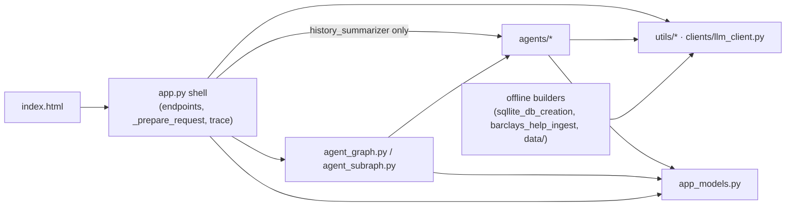
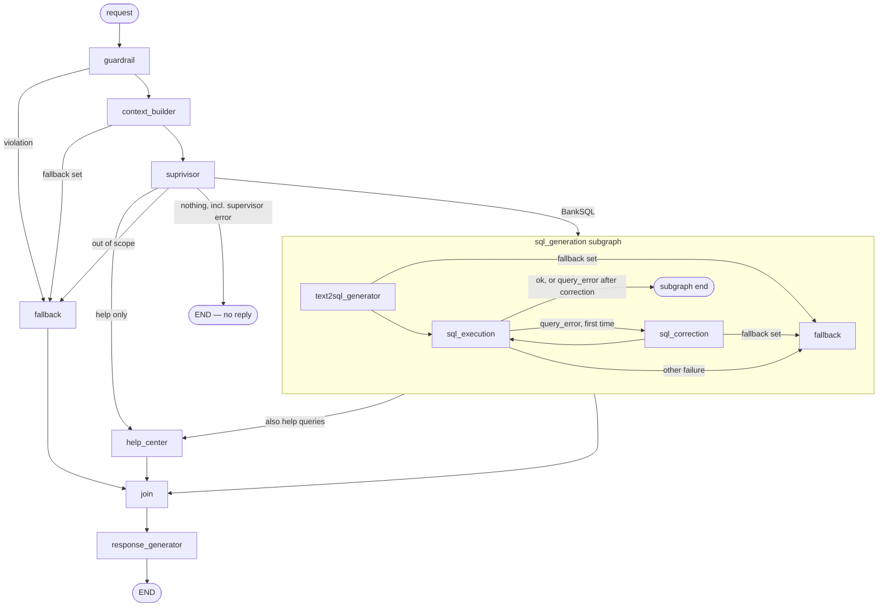
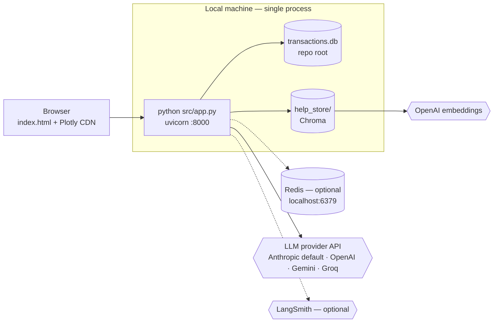
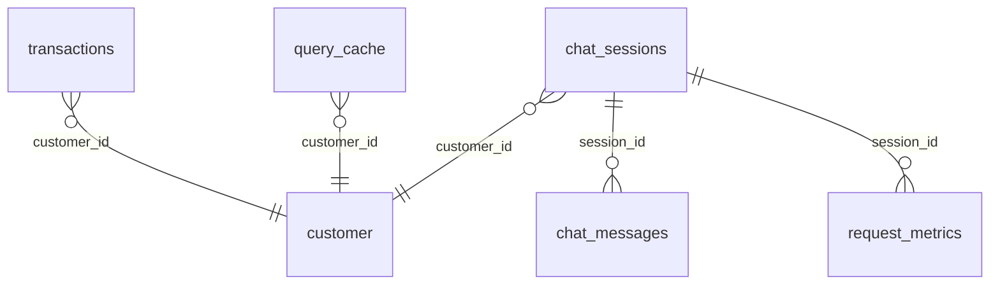

# Architecture Spine — FinTell baseline

Each AD gives the **Rule** that new or changed code follows. Where existing code doesn't comply, the AD lists it under **As-is**. Those items are recorded, not endorsed, and none is fixed by this spine.

## Design Paradigm

**Blackboard pipeline inside an imperative shell.** One typed state object (`Graph_State`, `src/app_models.py`) is the blackboard. LangGraph nodes are stages that read it and write fields back. Routing is deterministic Python in router functions, never LLM-autonomous. FastAPI is the shell: it does all I/O before and after the graph.

| Layer | Lives in | Owns |
| --- | --- | --- |
| Shell — inbound | `src/app.py` (`lifespan`, `_prepare_request`), `src/dependencies.py` | Startup singletons, history load/seed/summarise, building the initial state, compiling graphs per request |
| Pipeline — orchestration | `src/agent_graph.py`, `src/agent_subraph.py` | Node wiring and routers; thin wrappers only |
| Pipeline — stages | `src/agents/*.py` | One async function per stage; mutate state only |
| Shell — outbound | `src/app.py` (`/process`, `/process-stream`, `_build_agent_trace`) | Persistence after the graph, response envelope, SSE |
| Infrastructure | `src/clients/llm_client.py`, `src/utils/` | LLM factory, DB/Redis/Chroma helpers, prompt loading, metrics |
| Offline builders | `src/clients/sqllite_db_creation.py`, `src/clients/barclays_help_ingest.py`, `data/` | Building `transactions.db` and `help_store/`; never run by the app |

Dependencies point only along the arrows. `agents/*` never import `app.py`, `agent_graph.py` or each other. `app_models.py` imports nothing project-internal.

## Invariants & Rules

### AD-1 — Deterministic routing over shared state [ADOPTED]

- **Binds:** `agent_graph.py`, `agent_subraph.py`, every new node
- **Prevents:** stages calling each other directly or an LLM choosing the next node, which would give flows that the routers and trace can't predict
- **Rule:** Stages talk only through `Graph_State` fields. Flow is decided only by router functions reading state, never by a stage invoking another stage.

### AD-2 — Stages mutate state; the shell owns persistence [ADOPTED]

- **Binds:** all of `src/agents/`, `/process`, `/process-stream`, `_prepare_request`
- **Prevents:** two writers of chat history, messages or metrics
- **Rule:** Stages never write Redis chat history or the `chat_sessions`, `chat_messages` or `request_metrics` tables. Only the shell writes them. The one sanctioned exception is `text2sql_generator`, which reads and writes the SQL cache (Redis `qcache:*`, SQLite `query_cache`).
- **As-is:**
  - `_prepare_request` writes the compressed history to Redis before the graph runs.
  - `text2sql_generator` caches SQL before execution, so SQL that later fails and gets corrected stays cached.

### AD-3 — One assembler of the reply; new outputs are state fields [ADOPTED]

- **Binds:** `response_generator`, the endpoints, any new output type
- **Prevents:** reply text built in two places; endpoints computing content instead of wrapping it
- **Rule:**
  - `response_generator` is the only producer of `response_generation_response`. It joins, in order, the fallback message, the help answer and the SQL rephrase.
  - Any other user-facing output is produced in the graph as its own typed `Graph_State` field.
  - The endpoints only serialise state into the envelope. How the envelope grows is an open question (see Deferred).

### AD-4 — Outer and inner states stay field-compatible [ADOPTED]

- **Binds:** `Graph_State`, `SubGraph_State`
- **Prevents:** subgraph fields silently dropped or mistyped when the subgraph runs as a node of the outer graph
- **Rule:** Any field the SQL subgraph reads or writes is declared with the same name, type and default in both models. New fields carry a default.

### AD-5 — Branches run sequentially, never in parallel [ADOPTED]

- **Binds:** `_supervisor_router`, `_after_sql_router`, `join`, any new branch
- **Prevents:** concurrent writes to `agent_metrics` and other shared fields (they have no reducers, so the last writer wins)
- **Rule:**
  - `_supervisor_router` returns one primary route (BankSQL, else help, else fallback).
  - Any extra branch is chained sequentially, and every path converges at `join` before `response_generator`.
  - Who owns the branch order and the label-to-branch mapping is an open question (see Deferred).

### AD-6 — Stage contract [ADOPTED]

- **Binds:** every new function in `src/agents/`
- **Prevents:** stages that crash the graph, skip metrics, or have shapes the wrappers can't call
- **Rule:**
  - Signature is `(state, llm, prompt, logger, *extras)`, and the function returns the state.
  - Structured calls use `llm.with_structured_output(Model, include_raw=True)`. Only nodes whose text is shown to the user stream plain text with `llm.astream`.
  - Metrics go to `state.agent_metrics["<metrics key>"]` via `agent_utils.agent_metrics()`, after a `None → {}` guard, because the initial state has `agent_metrics=None`.
  - The whole body is in `try/except Exception`, which sets `state.fallback_response = FallbackResponse(...)`. A stage never raises.
- **As-is:**
  - `input_guardrail_node(state, llm, logger)`, `fallback_agent(state, logger)`, `execute_query(state, db_conn, logger)` and `help_center_agent(state, llm, prompt, help_store, logger)` don't follow the signature.
  - `execute_query` catches only `sqlite3.Error`, and does work outside its `try`.
  - `text2sql_generator` and `sql_correction` write `agent_metrics` without the guard, relying on `guardrail` to have set it.
  - Both graph classes compile in `__init__` before assigning `logger` (and, in `Agent_SubGraph`, `db_conn` and `redis_client`). Compilation must not call node methods.

### AD-7 — Failure travels as state [ADOPTED]

- **Binds:** all routers, `fallback`, `sql_correction`, `response_generator`
- **Prevents:** loops that never end, and errors escaping to the endpoint as a 500
- **Rule:**
  - Failure is signalled only through `state.fallback_response`.
  - Any new router placed after a stage that can fail checks `fallback_response` first.
  - `fallback_message` is always text that is safe to show the user verbatim, because `response_generator` prepends it to the reply.
  - `sql_correction` runs at most once per request, guarded by `state.sql_query_correction`.
- **As-is:**
  - `_guardrail_router`, `_context_builder_router` and the subgraph routers check `fallback_response`; `_supervisor_router` and `_after_sql_router` do not.
  - A supervisor exception leaves the query lists `None`, so `_supervisor_router` returns `END`, which skips `join` and `response_generator` and leaves no reply.
  - A `query_error` that remains after correction leaves the subgraph through `end`, not `fallback`, and the user sees "…Attempting automatic correction."
  - A `help_center` failure reaches `response_generator` without going through `fallback`.

### AD-8 — Prompts are YAML templates used raw [ADOPTED]

- **Binds:** `prompts/*.yml`, `AppSettings`, `Prompts`, `get_all_prompts`
- **Prevents:** prompts that are formatted twice, and prompts that are declared but never loaded
- **Rule:**
  - Each prompt file has a single `prompt:` key.
  - Agents send `prompt.template` as the system message with `cache_control` (ephemeral, 1h), and build the user message with f-strings. They never call `PromptTemplate.format`.
  - A new prompt is added to `AppSettings`, `Prompts` and `get_all_prompts` together.
  - The `guardrail` prompt is the one hardcoded exception.

### AD-9 — Data ownership [ADOPTED]

- **Binds:** `transactions.db`, `help_store/`, `db_utils`, the offline builders
- **Prevents:** two writers of one table; schema drift between data, prompts and code
- **Rule:**
  - The `transactions` table is written only by `sqllite_db_creation.py`, from `df_transaction_data_enhanced.xlsx`. No new app code writes it.
  - `chat_sessions`, `chat_messages`, `request_metrics` and `query_cache` are created and written only through `utils/db_utils.py`.
  - `help_store/` is written only by `barclays_help_ingest.py`, and the app only queries it through `HelpStore`.
  - A change to the `transactions` schema also updates `prompts/suprivisor_prompt.yml` and `prompts/text2sql_generator.yml`, and clears the SQL cache.
- **As-is:**
  - The app being read-only is intended, not enforced: see AD-11.
  - `sqllite_db_creation.py` replaces the whole DB file, so it wipes the app tables too.

### AD-10 — Row ceiling at execution [ADOPTED]

- **Binds:** `sql_execution`, every consumer of `database_query_results`
- **Prevents:** unbounded detail lists reaching the LLM or the UI
- **Rule:** Detail SELECTs (no aggregate function) are capped at `MAX_RESULT_ROWS` (20) inside `sql_execution`. Consumers expect at most 20 rows, plus an optional trailing notice string. Queries that contain an aggregate, including `GROUP BY` results, are not capped.

### AD-11 — Customer scoping is prompt-only (as-is) [ADOPTED]

- **Binds:** `text2sql_generator`, `prompts/text2sql_generator.yml`, `sql_execution`, `/process`, `/process-stream`
- **Prevents:** a contributor assuming code-level enforcement that doesn't exist
- **Rule:**
  - Never remove or weaken the customer-scoping instructions in the text2sql prompt.
  - New code that runs SQL derived from user input goes through `sql_execution`, never a separate path.
- **As-is:**
  - Isolation between customers relies on the prompt adding `WHERE customer_id = '<customer_id>'`.
  - `/process` trusts the `customer_id` in the request body.
  - `sql_execution` runs any SQL it receives, and commits non-SELECT statements on the same connection that holds the app tables.
  - Hardening is deferred.

### AD-12 — Node identity and shell registration [ADOPTED]

- **Binds:** any new or renamed graph node
- **Prevents:** a node that runs but is missing from progress steps, the trace or token streaming, or whose ids don't match what routers compare against
- **Rule:**
  - A new node uses one id, unique across both graphs, for its node name, metrics key, trace `agent`, `fallback_node` and UI icon key.
  - It is registered in:
    - `_STREAM_STEP_LABELS` (`app.py`)
    - `_build_agent_trace` (`app.py`)
    - the token-stream allowlist in `/process-stream`, only if it streams user-facing text
    - the trace icon map in `index.html`
  - `fallback_node` values are compared as strings (`"guardrail"` in `fallback.py` and `app.py`), so they are ids, not free text.
- **As-is aliases (frozen; add no new ones):**

  | Node | Metrics key | Trace agent / `fallback_node` |
  | --- | --- | --- |
  | `suprivisor` | `suprivisor` | `supervisor` |
  | `sql_generation` (outer: the whole subgraph; inner: the generator) | `text2sql_generator` | `text2sql_generator` |
  | `fallback` (in both graphs) | — | `fallback_agent` is written to `fallback_node`, overwriting the origin |

### AD-13 — Endpoint parity [ADOPTED]

- **Binds:** `/process`, `/process-stream`
- **Prevents:** the streaming and non-streaming paths returning different envelopes or persisting differently
- **Rule:** Both endpoints persist the same things after the graph and return the same `{response, visualization, agent_trace}` keys (the SSE `final` event carries the same keys). Any change lands in both identically.
- **As-is:** When there is no `response_generation_response` (see AD-7), `/process` returns a 500 and persists nothing. `/process-stream` substitutes the technical message and persists it. An exception produces an SSE `error` event.

### AD-14 — Shared singletons and the single-instance envelope [ADOPTED]

- **Binds:** `lifespan`, `dependencies.py`, `/update-settings`, all stages
- **Prevents:** per-request or per-agent clients that bypass hot-swap, hold extra SQLite connections, or assume isolation that doesn't exist
- **Rule:**
  - One LLM, one SQLite connection, one Redis client and one `HelpStore` are created in `lifespan` and reach code only through `app.state` / `dependencies.py`.
  - Chat models are built only through `clients/llm_client.get_configured_llm`. Embeddings come only through `get_openai_embeddings`, which is always OpenAI.
  - Graphs are compiled per request, so they pick up the LLM currently in `app.state`.
  - The system runs as a single process and single instance, as a local demo only.

### AD-15 — Optional services degrade, never block startup [ADOPTED]

- **Binds:** `lifespan`, Redis users, `help_center`
- **Prevents:** a missing local service crashing the app
- **Rule:**
  - Redis or Chroma being unavailable sets its handle to `None`, and the app still starts.
  - Every consumer null-checks the handle. Without Redis, history and caching are skipped. Without Chroma, the help branch gives its grounded "couldn't find it" reply.
  - A new optional service follows the same pattern.

### AD-16 — Operations envelope [ADOPTED]

- **Binds:** `lifespan`, the graph-invoking endpoints, `utils/agent_utils.agent_metrics`, all LLM calls
- **Prevents:** new endpoints or telemetry that diverge from the existing operational defaults
- **Rule:**
  - Any endpoint that invokes the graph carries `@limiter.limit("20/minute")` (slowapi, keyed by remote address).
  - LangSmith tracing is enabled only when `LANGCHAIN_API_KEY` is set.
  - Per-node `Metrics` (tokens, latency, cost) are persisted to `request_metrics` by the shell and are the only cost and latency record.
- **As-is:**
  - Cost uses hard-coded Claude Haiku 4.5 rates whatever the active model, so the figures are only indicative.
  - The `cache_control` blocks are Anthropic-specific and are sent to every provider.

## Consistency Conventions

| Concern | Convention |
| --- | --- |
| Naming | One id per new node (AD-12). Agent modules sit in `src/agents/`. The misspelling `suprivisor` is load-bearing (filename, `Prompts` field, node, `Graph_State.suprivisor_response`). |
| Models | All state and LLM output models are Pydantic in `src/app_models.py`. A new stage's output is one typed model stored on one state field. |
| Money & direction | `amount_usd` is always positive; direction comes from `transaction_type ∈ {income, payment, direct_debit, standing_order}`. `balance` is the running balance after the row. |
| Result rows | `database_query_results` is `list[str]`, each item a `str(dict)` of one row. |
| Config | `AppSettings` (pydantic-settings). `.env` is loaded by `llm_client` via `python-dotenv`. Env values override defaults. |
| Errors | `FallbackResponse(fallback_flag, fallback_node, fallback_reason, fallback_message)`. The `fallback_reason` values in use are `exception`, `query_error` and guardrail violation labels. A new reason must be handled in `fallback_agent` and in any router that branches on it. |
| Logging | Runtime code (shell, pipeline, `utils/`) uses the one logger from `setup_logging()`, passed into stages; never `print`. The offline builders in `src/clients/` print to the console. |
| Keys | Redis `chat:{customer_id}:{session_id}` (TTL `REDIS_TTL`); SQL cache `qcache:{customer_id}:{sha256[:16]}` (24h in Redis; never expires in SQLite). |
| Streaming | SSE events are `step` (per completed node), `token` (allowlisted nodes only), `final`, `error`. |

## Stack

| Name | Version |
| --- | --- |
| Python | 3.11+ |
| FastAPI | 0.136.0 |
| uvicorn | 0.41.0 |
| LangGraph | 1.0.8 |
| langchain-core | 1.2.13 |
| langchain | 1.2.10 |
| langchain-openai | 1.1.10 |
| langchain-anthropic / langchain-google-genai / langchain-groq | unpinned in requirements.txt (drift risk) |
| langchain-chroma | 1.1.0 |
| chromadb | 1.5.0 |
| pydantic | 2.13.2 |
| pydantic-settings | 2.13.0 |
| redis (client) | 7.2.0 |
| slowapi | 0.1.9 |
| pandas | 3.0.1 |
| SQLite | stdlib `sqlite3` |
| Plotly.js (UI, CDN) | 2.35.2 |
| Default chat model (`ANTHROPIC_MODEL`) | `claude-sonnet-4-6` — active |
| `OPENAI_MODEL` | `gpt-4o-mini` — API removal reported for 2027-01-14 |
| `GEMINI_MODEL` | `gemini-1.5-flash` — retired upstream; non-functional as-is |
| `GROQ_MODEL` | `llama3-70b-8192` — retired upstream; non-functional as-is |
| Embedding model | `text-embedding-3-small` — active |

## Structural Seed

**Unused visualization code:** these all exist, but no node produces them, so `visualization` is always `null`:
- `VisualizationDecision` and `VisualizationResponse` (`app_models.py`)
- `Graph_State.visualization_response`
- the `visualization` envelope key
- the `visualization_agent` entries in `_STREAM_STEP_LABELS` and `_build_agent_trace`
- the Plotly renderer and icon in `index.html`
- the unimported Python `plotly` package in `requirements.txt`

This code is a current fact, not a design to follow.

## Deferred

| Item | Why it can wait | Revisit when |
| --- | --- | --- |
| Who may write `fallback_response`. An optional stage failing today diverts or prefixes the whole reply, and `fallback` overwrites `fallback_node`. | Only one failure path is exercised per request today | Architecture of the next feature that adds a graph node |
| Who owns the branch order and the label-to-branch mapping. Today it is hand-wired edges and the `else` in `supervisor.py`. | Two branches only | Architecture of the next feature that adds a branch or class label |
| How the envelope grows for new outputs, and whether or how new outputs are persisted with `chat_messages` | No second output type exists | Architecture of the next feature that adds an output type |
| How `agent_metrics` merges. It has no reducer; whole-field returns would overwrite it. | All stages mutate it in place today | Architecture of the next feature that adds a node or subgraph |
| Fixing the AD-7 and AD-13 as-is defects (supervisor error → no reply; leftover `query_error` message; endpoint divergence) | Rare in the demo | When either is hit in a demo, or with the next change to routing or the endpoints |
| Code-level customer isolation and read-only SQL (enforcing `customer_id`, a read-only connection for `sql_execution`, authenticated identity, protecting `/update-settings` and `/chat-history`) | Local demo with seeded data (AD-11) | Before any shared, hosted or real-data use |
| A central node registry replacing the manual registration in AD-12 | Manual registration is workable at the current node count | When adding more than one new node, or when a registration miss ships |
| Merging the duplicated post-graph logic into one helper (AD-13) | Parity rule covers changes | Together with the envelope-growth decision above |
| Scaling: multiple workers or instances, per-request LLM isolation, connection pooling, deployment target, CI | Local demo, single instance (AD-14) | When leaving local demo |
| Non-default model ids (Gemini and Groq retired; OpenAI removal reported for 2027-01-14) and pinning the provider packages | Default Anthropic path works | Before using `/update-settings` with another provider, and before 2027-01-14 |
| Model-aware cost pricing; provider-portable cache hints | Indicative figures are enough for the demo | When cost figures are used for decisions |
| Automated tests | No suite exists; `tests/data/` holds evaluation datasets only | When a feature needs a regression guard |
| SQL cache invalidation on prompt or schema change | Manual clearing documented in AGENTS.md | When prompts change often or stale SQL ships |
| Fate of the unused visualization code | Out of scope for the baseline | The chart feature's PRD and architecture |
