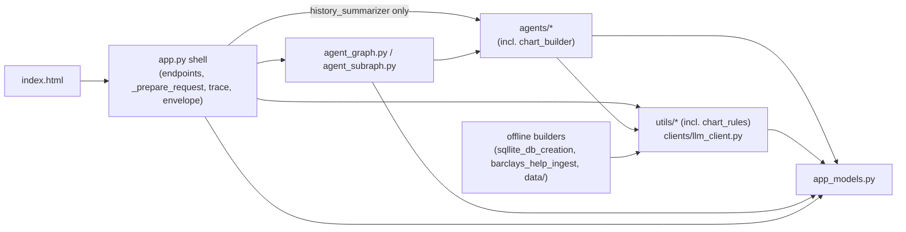
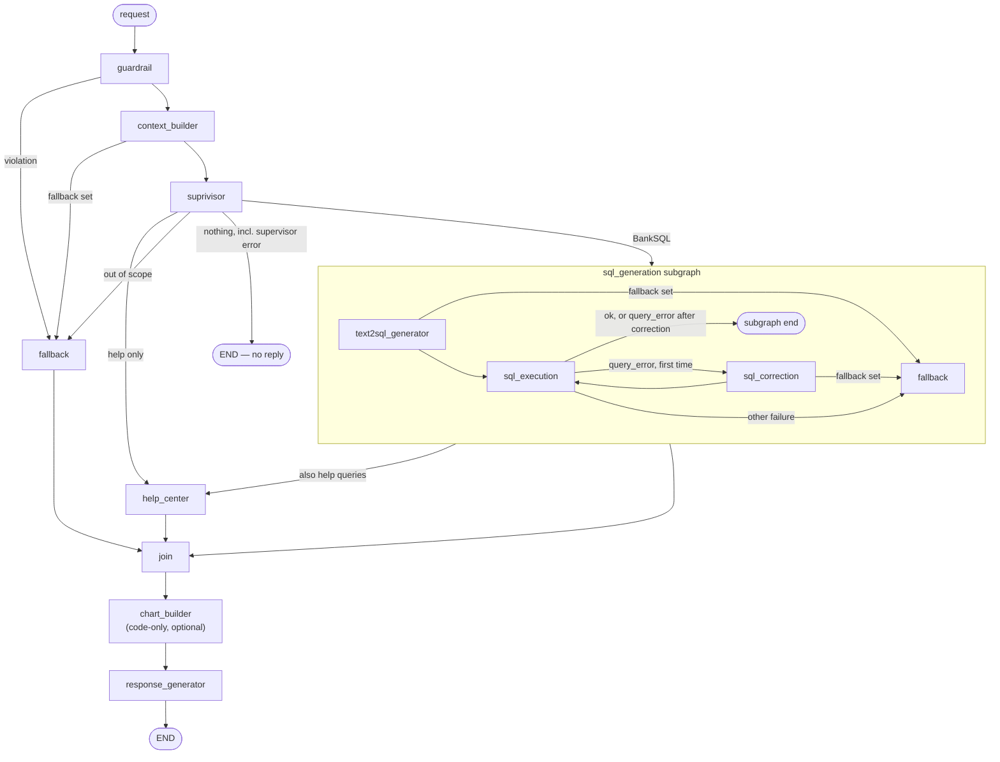
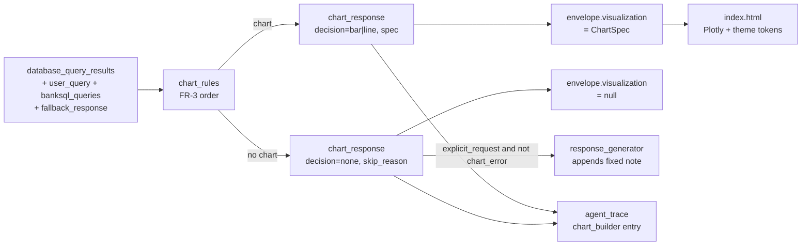
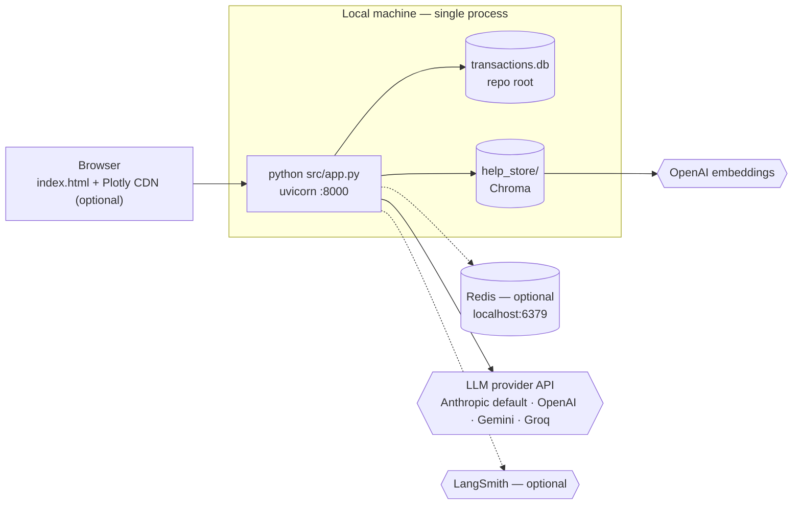
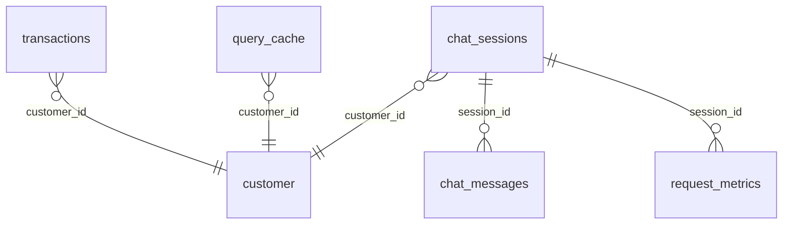

# Architecture Spine — FinTell baseline + Transaction Charts

Each AD gives the **Rule** that new or changed code follows. Where existing code doesn't comply, the AD lists it under **As-is**. Those items are recorded, not endorsed, and none is fixed by this spine unless a **Chart feature** line says so. AD-17 to AD-25 are new for the chart feature. Requirement IDs (FR-n, SM-n, UJ-n) refer to the Transaction Charts PRD. Calls not yet confirmed by the owner carry `[ASSUMPTION]`.

## Design Paradigm

**Blackboard pipeline inside an imperative shell.** One typed state object (`Graph_State`, `src/app_models.py`) is the blackboard. LangGraph nodes are stages that read it and write fields back. Routing is deterministic Python in router functions, never LLM-autonomous. FastAPI is the shell: it does all I/O before and after the graph. The chart feature adds one deterministic, code-only stage and one output field; it does not change the paradigm.

| Layer | Lives in | Owns |
| --- | --- | --- |
| Shell — inbound | `src/app.py` (`lifespan`, `_prepare_request`), `src/dependencies.py` | Startup singletons, history load/seed/summarise, building the initial state, compiling graphs per request |
| Pipeline — orchestration | `src/agent_graph.py`, `src/agent_subraph.py` | Node wiring and routers; thin wrappers only |
| Pipeline — stages | `src/agents/*.py` | One async function per stage; mutate state only |
| Shell — outbound | `src/app.py` (`/process`, `/process-stream`, `_build_agent_trace`, the shared envelope helper) | Persistence after the graph, response envelope, SSE |
| Infrastructure | `src/clients/llm_client.py`, `src/utils/` (incl. the pure chart rules) | LLM factory, DB/Redis/Chroma helpers, prompt loading, metrics, chart rules |
| UI | `src/index.html` | Rendering the Text Reply, the Chart (styling and theme), the trace panel |
| Offline builders | `src/clients/sqllite_db_creation.py`, `src/clients/barclays_help_ingest.py`, `data/` | Building `transactions.db` and `help_store/`; never run by the app |

Dependencies point only along the arrows. `agents/*` never import `app.py`, `agent_graph.py` or each other. `app_models.py` imports nothing project-internal. Anything two agents both need (for example `SkipReason`) lives in `app_models.py` or `utils/`.

## Invariants & Rules

### AD-1 — Deterministic routing over shared state [ADOPTED]

- **Binds:** `agent_graph.py`, `agent_subraph.py`, every new node
- **Prevents:** stages calling each other directly or an LLM choosing the next node, which would give flows that the routers and trace can't predict
- **Rule:** Stages talk only through `Graph_State` fields. Flow is decided only by router functions reading state, never by a stage invoking another stage.

### AD-2 — Stages mutate state; the shell owns persistence [ADOPTED]

- **Binds:** all of `src/agents/`, `/process`, `/process-stream`, `_prepare_request`
- **Prevents:** two writers of chat history, messages or metrics
- **Rule:** Stages never write Redis chat history or the `chat_sessions`, `chat_messages` or `request_metrics` tables. Only the shell writes them. The one sanctioned exception is `text2sql_generator`, which reads and writes the SQL cache (Redis `qcache:*`, SQLite `query_cache`).
- **As-is:**
  - `_prepare_request` writes the compressed history to Redis before the graph runs.
  - `text2sql_generator` caches SQL before execution, so SQL that later fails and gets corrected stays cached.

### AD-3 — One assembler of the reply; new outputs are state fields [ADOPTED]

- **Binds:** `response_generator`, the endpoints, any new output type
- **Prevents:** reply text built in two places; endpoints computing content instead of wrapping it
- **Rule:**
  - `response_generator` is the only producer of `response_generation_response`. It joins, in order, the fallback message, the help answer, the SQL rephrase and, last, the FR-5 no-chart note (AD-21).
  - Any other user-facing output is produced in the graph as its own typed `Graph_State` field. The Chart is the second output type (`chart_response`, AD-19).
  - The endpoints only serialise state into the envelope (AD-22).

### AD-4 — Outer and inner states stay field-compatible [ADOPTED]

- **Binds:** `Graph_State`, `SubGraph_State`
- **Prevents:** subgraph fields silently dropped or mistyped when the subgraph runs as a node of the outer graph
- **Rule:** Any field the SQL subgraph reads or writes is declared with the same name, type and default in both models. New fields carry a default. Fields only outer-graph stages touch (such as `chart_response`) go in `Graph_State` only.

### AD-5 — Branches run sequentially, never in parallel [ADOPTED]

- **Binds:** `_supervisor_router`, `_after_sql_router`, `join`, any new branch or post-join stage
- **Prevents:** concurrent writes to `agent_metrics` and other shared fields (they have no reducers, so the last writer wins)
- **Rule:**
  - `_supervisor_router` returns one primary route (BankSQL, else help, else fallback).
  - Any extra branch is chained sequentially, and every path converges at `join`.
  - Stages after `join` form one straight line: `join → chart_builder → response_generator` (AD-17).
  - The chart feature adds no branch and no supervisor class label. Who owns the branch order and the label-to-branch mapping stays open (see Deferred).

### AD-6 — Stage contract [ADOPTED, amended for the chart feature]

- **Binds:** every new function in `src/agents/`
- **Prevents:** stages that crash the graph, skip metrics, or have shapes the wrappers can't call
- **Rule:**
  - LLM stages: the signature is `(state, llm, prompt, logger, *extras)`. Code-only stages: `(state, logger, *extras)`. Both return the state.
  - Structured calls use `llm.with_structured_output(Model, include_raw=True)`. Only nodes whose text is shown to the user stream plain text with `llm.astream`.
  - LLM stages store metrics in `state.agent_metrics["<metrics key>"]` via `agent_utils.agent_metrics()`, after a `None → {}` guard, because the initial state has `agent_metrics=None`. Merge rules: AD-24.
  - The whole body is in `try/except Exception`. A stage never raises. A **required** stage's handler sets `state.fallback_response = FallbackResponse(...)`. An **optional** stage's handler follows AD-18 instead.
- **As-is:**
  - `input_guardrail_node(state, llm, logger)`, `fallback_agent(state, logger)`, `execute_query(state, db_conn, logger)` and `help_center_agent(state, llm, prompt, help_store, logger)` don't follow the signature.
  - `execute_query` catches only `sqlite3.Error`, and does work outside its `try`.
  - `text2sql_generator` and `sql_correction` write `agent_metrics` without the guard, relying on `guardrail` to have set it.
  - Both graph classes compile in `__init__` before assigning `logger` (and, in `Agent_SubGraph`, `db_conn` and `redis_client`). Compilation must not call node methods.

### AD-7 — Failure travels as state [ADOPTED, amended for the chart feature]

- **Binds:** all routers, `fallback`, `sql_correction`, `response_generator`
- **Prevents:** loops that never end, and errors escaping to the endpoint as a 500
- **Rule:**
  - A required stage signals failure only through `state.fallback_response`. Optional stages never do (AD-18).
  - Any new router placed after a stage that can fail checks `fallback_response` first. An optional stage needs no router after it.
  - `fallback_message` is always text that is safe to show the user verbatim, because `response_generator` prepends it to the reply.
  - `sql_correction` runs at most once per request, guarded by `state.sql_query_correction`.
- **As-is:**
  - `_guardrail_router`, `_context_builder_router` and the subgraph routers check `fallback_response`; `_supervisor_router` and `_after_sql_router` do not.
  - A supervisor exception leaves the query lists `None`, so `_supervisor_router` returns `END`, which skips `join`, `chart_builder` and `response_generator` and leaves no reply. The PRD exempts this path from FR-3 and FR-14.
  - A `query_error` that remains after correction leaves the subgraph through `end`, not `fallback`, and the user sees "…Attempting automatic correction."
  - A `help_center` failure reaches `response_generator` without going through `fallback`.
  - `needs_separate_questions` sets `fallback_response` with `fallback_message=None`.

### AD-8 — Prompts are YAML templates used raw [ADOPTED]

- **Binds:** `prompts/*.yml`, `AppSettings`, `Prompts`, `get_all_prompts`
- **Prevents:** prompts that are formatted twice, and prompts that are declared but never loaded
- **Rule:**
  - Each prompt file has a single `prompt:` key.
  - Agents send `prompt.template` as the system message with `cache_control` (ephemeral, 1h), and build the user message with f-strings. They never call `PromptTemplate.format`.
  - A new prompt is added to `AppSettings`, `Prompts` and `get_all_prompts` together.
  - The `guardrail` prompt is the one hardcoded exception.
- **Chart feature:** no new prompt file. Text changes to four existing prompts:
  - `text2sql_generator.yml` gets the AD-20 column convention and the FR-15 balance guidance.
  - `suprivisor_prompt.yml` handles chart wording (AD-21).
  - `sql_correction.yml` gets its stale schema fixed (it lists `country`/`card_type` but lacks `transaction_type` and `balance`), and must keep the output column names of the SQL it repairs.
  - `response_generator_prompt.yml` tells the model never to mention charts, because the note is code-written (AD-21).

### AD-9 — Data ownership [ADOPTED]

- **Binds:** `transactions.db`, `help_store/`, `db_utils`, the offline builders
- **Prevents:** two writers of one table; schema drift between data, prompts and code
- **Rule:**
  - The `transactions` table is written only by `sqllite_db_creation.py`, from `df_transaction_data_enhanced.xlsx`. No new app code writes it.
  - `chat_sessions`, `chat_messages`, `request_metrics` and `query_cache` are created and written only through `utils/db_utils.py`.
  - `help_store/` is written only by `barclays_help_ingest.py`, and the app only queries it through `HelpStore`.
  - A change to the `transactions` schema also updates `prompts/suprivisor_prompt.yml`, `prompts/text2sql_generator.yml` and `prompts/sql_correction.yml`, and clears the SQL cache.
  - The FR-15 tie-break (AD-20) relies on the builder writing rows so that `(transaction_date, transaction_id)` order reproduces the running `balance`. Verified on the current DB (3950/3950 rows). A builder change that alters row order re-checks this.
- **As-is:**
  - The app being read-only is intended, not enforced: see AD-11.
  - `sqllite_db_creation.py` replaces the whole DB file, so it wipes the app tables too.

### AD-10 — Row ceiling at execution [ADOPTED, as-is corrected]

- **Binds:** `sql_execution`, every consumer of `database_query_results`
- **Prevents:** unbounded result lists reaching the LLM, the chart rules or the UI
- **Rule:** `sql_execution` is the only place results are capped. Consumers expect at most 20 rows, plus an optional trailing notice string (`[System Notification: …]`), and must skip that string when parsing rows.
- **As-is (corrected from the baseline):**
  - SQL rewrite: a query that starts with `SELECT` and has no aggregate function (`count|sum|avg|min|max|group_concat(`) gets `LIMIT 20`, plus `ORDER BY transaction_date DESC` if it has no `ORDER BY`. An explicit larger `LIMIT` is clamped to 20. Queries starting with `WITH` skip the rewrite.
  - Python hard cap: **any** result longer than 20 rows, aggregate or not, is cut to 20 and gets the notice string appended. The baseline said aggregates were uncapped; they are not.
- **Chart feature:**
  - The rewrite also treats `OVER (` and `GROUP BY` as aggregates. Otherwise a window-function balance query gets a silent `LIMIT 20` with no notice, and a 30-point series would chart as 20 points.
  - A truncated result is classified by AD-20.

### AD-11 — Customer scoping is prompt-only (as-is) [ADOPTED]

- **Binds:** `text2sql_generator`, `prompts/text2sql_generator.yml`, `sql_execution`, `/process`, `/process-stream`
- **Prevents:** a contributor assuming code-level enforcement that doesn't exist
- **Rule:**
  - Never remove or weaken the customer-scoping instructions in the text2sql prompt.
  - Every new prompt rule or example applies `customer_id = '<customer_id>'` in **every** subquery and CTE, not only the outer query. The FR-15 balance guidance (AD-20) is the first such change.
  - New code that runs SQL derived from user input goes through `sql_execution`, never a separate path. The chart path runs no SQL at all.
- **As-is:**
  - Isolation between customers relies on the prompt adding `WHERE customer_id = '<customer_id>'`.
  - `/process` trusts the `customer_id` in the request body.
  - `sql_execution` runs any SQL it receives, and commits non-SELECT statements on the same connection that holds the app tables.
  - Hardening is deferred.

### AD-12 — Node identity and shell registration [ADOPTED]

- **Binds:** any new or renamed graph node
- **Prevents:** a node that runs but is missing from progress steps, the trace or token streaming, or whose ids don't match what routers compare against
- **Rule:**
  - A new node uses one id, unique across both graphs, for its node name, metrics key, trace `agent`, `fallback_node` and UI icon key.
  - It is registered in:
    - `_STREAM_STEP_LABELS` (`app.py`). A value of `None` registers the node as silent (no `step` event).
    - `_build_agent_trace` (`app.py`)
    - the token-stream allowlist in `/process-stream`, only if it streams user-facing text
    - the trace icon map and the per-agent branch of `buildDetails` in `index.html`
  - `fallback_node` values are compared as strings (`"guardrail"` in `fallback.py` and `app.py`), so they are ids, not free text.
- **Chart feature:** the new node's id is `chart_builder`. It is silent in `_STREAM_STEP_LABELS` `[ASSUMPTION — UX may give it a label]`, always present in the trace when `chart_response` is set, not on the token allowlist, and has a `chart_builder` icon. All `visualization_agent` entries are removed.
- **As-is aliases (frozen; add no new ones):**

  | Node | Metrics key | Trace agent / `fallback_node` |
  | --- | --- | --- |
  | `suprivisor` | `suprivisor` | `supervisor` |
  | `sql_generation` (outer: the whole subgraph; inner: the generator) | `text2sql_generator` | `text2sql_generator` |
  | `fallback` (in both graphs) | — | `fallback_agent` is written to `fallback_node`, overwriting the origin |

### AD-13 — Endpoint parity [ADOPTED]

- **Binds:** `/process`, `/process-stream`
- **Prevents:** the streaming and non-streaming paths returning different envelopes or persisting differently
- **Rule:** Both endpoints persist the same things after the graph and return the same `{response, visualization, agent_trace}` keys (the SSE `final` event carries the same keys). Any change lands in both identically. `visualization` and `agent_trace` are built by shared helpers both endpoints call (AD-22).
- **As-is:** When there is no `response_generation_response` (see AD-7), `/process` returns a 500 and persists nothing. `/process-stream` substitutes the technical message and persists it. An exception produces an SSE `error` event. SM-4 excludes these paths.

### AD-14 — Shared singletons and the single-instance envelope [ADOPTED]

- **Binds:** `lifespan`, `dependencies.py`, `/update-settings`, all stages
- **Prevents:** per-request or per-agent clients that bypass hot-swap, hold extra SQLite connections, or assume isolation that doesn't exist
- **Rule:**
  - One LLM, one SQLite connection, one Redis client and one `HelpStore` are created in `lifespan` and reach code only through `app.state` / `dependencies.py`.
  - Chat models are built only through `clients/llm_client.get_configured_llm`. Embeddings come only through `get_openai_embeddings`, which is always OpenAI.
  - Graphs are compiled per request, so they pick up the LLM currently in `app.state`.
  - The system runs as a single process and single instance, as a local demo only.

### AD-15 — Optional services degrade, never block startup [ADOPTED]

- **Binds:** `lifespan`, Redis users, `help_center`, the UI chart renderer
- **Prevents:** a missing local service crashing the app
- **Rule:**
  - Redis or Chroma being unavailable sets its handle to `None`, and the app still starts.
  - Every consumer null-checks the handle. Without Redis, history and caching are skipped. Without Chroma, the help branch gives its grounded "couldn't find it" reply.
  - A new optional service follows the same pattern. In the browser, Plotly.js is one: the UI checks it is loaded before drawing (AD-23).

### AD-16 — Operations envelope [ADOPTED]

- **Binds:** `lifespan`, the graph-invoking endpoints, `utils/agent_utils.agent_metrics`, all LLM calls
- **Prevents:** new endpoints or telemetry that diverge from the existing operational defaults
- **Rule:**
  - Any endpoint that invokes the graph carries `@limiter.limit("20/minute")` (slowapi, keyed by remote address). The chart feature adds no endpoint.
  - LangSmith tracing is enabled only when `LANGCHAIN_API_KEY` is set.
  - Per-node `Metrics` (tokens, latency, cost) are persisted to `request_metrics` by the shell and are the only cost and latency record. The Chart Decision is not persisted there (AD-22).
- **As-is:**
  - Cost uses hard-coded Claude Haiku 4.5 rates whatever the active model, so the figures are only indicative.
  - The `cache_control` blocks are Anthropic-specific and are sent to every provider.

### AD-17 — One code-only chart stage after `join` [NEW]

- **Binds:** `agent_graph.py`, `src/agents/chart_builder.py`, `src/utils/chart_rules.py`
- **Prevents:** chart work delaying the first token (FR-10), a Chart Decision missing on some paths (FR-14), or a second chart writer
- **Rule:**
  - Exactly one node, `chart_builder`, makes the Chart Decision and builds the Chart. It sits on a plain edge `join → chart_builder → response_generator`, so it runs on every path that reaches `join`.
  - It makes no LLM call, no SQL call and no network call. It is a deterministic function of state: the same inputs always give the same `chart_response`.
  - `utils/chart_rules.py` is the single owner of the chart rules. It holds, as pure functions and constants:
    - the eligibility logic: the AD-20 decision table
    - the explicit-request pattern (AD-21)
    - the note strings and `note_due()` (AD-21)
    - the title, axis and point-label tables (AD-19)

    The node only reads state, calls `chart_rules` and writes `chart_response`. No other module re-implements any of these.
  - Two settings, `CHART_FEATURE_ENABLED` (default true) and `CHART_FAULT_INJECTION` (default false), reach the node from `_prepare_request` through `Agent_Graph`. Stages never build `AppSettings` themselves. When the feature is disabled, the node leaves `chart_response` as `None`: no Chart, no note and no trace entry. This is the "feature off" state for SM-3 and SM-C2. `[ASSUMPTION]`

### AD-18 — Optional stages never touch the fallback [NEW]

- **Binds:** `chart_builder`, any future stage whose failure must not change the Text Reply
- **Prevents:** a chart failure diverting or prefixing the reply (FR-13); two kinds of stage fighting over `fallback_response`
- **Rule:**
  - A stage is **optional** when its failure must leave the Text Reply unchanged. `chart_builder` is the first one.
  - An optional stage wraps its whole body in `try/except Exception` and never writes `fallback_response`. On failure it records its own outcome and logs the exception. For `chart_builder` that outcome is a `ChartResponse` built from literal constants only (`decision="none"`, `skip_reason="chart_error"`, `explicit_request=False`, `spec=None`), so the handler itself cannot fail validation.
  - Only required stages, `fallback` and the guardrail write `fallback_response`. Any stage may read it.
  - Fault injection for SM-5: when `CHART_FAULT_INJECTION` is true, `chart_builder` raises inside its own `try`. Run it as a separate pass over the dataset. `[ASSUMPTION]`

### AD-19 — The chart output contract [NEW]

- **Binds:** `app_models.py`, `chart_builder`, `response_generator`, `_build_agent_trace`, the envelope helper
- **Prevents:** two shapes for the same output; consumers guessing at skip reasons
- **Rule:**
  - `Graph_State.chart_response: ChartResponse | None = None` is written only by `chart_builder`, and is not in `SubGraph_State`.
  - `ChartResponse` carries `decision` (`bar` | `line` | `none`), `skip_reason` (`SkipReason | None`, set exactly when `decision` is `none`), `explicit_request` (bool) and `spec` (`ChartSpec | None`, set exactly when `decision` is not `none`).
  - `SkipReason` is one `Literal` in `app_models.py` holding the nine FR-3 labels, and every consumer imports it from there.
  - `ChartSpec` holds `chart_type` (`bar` | `line`), `title`, `x_label`, `y_label` and `points: list[ChartPoint]`.
  - Each `ChartPoint` is `label: str` plus `value: float`:
    - `label` is the **display** label, such as `"Mar 2026"`, `"Wk 12 2026"` or `"Dining"`.
    - `value` is finite, in USD, and rounded to 2 decimals. Net and balance values may be negative.
  - Points arrive already in plot order: by the raw ISO period for a line, and in Result order for a bar. `chart_rules` sorts on the raw period before it formats labels, so the UI never sorts or parses labels.
  - The title, the axis labels and the label formats come only from `chart_rules` tables, keyed by the AD-20 column names:
    - value column → measure, for example `spending` → "Spending"
    - label column → grouping, for example `merchant` → "Merchant"
    - grain → label format
    - the period phrase comes from `period_start`/`period_end` for a bar chart, or from the first and last period for a line chart. A bar chart without them gets a title with no period phrase.

### AD-20 — Result-shape contract between the text2sql prompt and the chart rules [NEW] `[ASSUMPTION]`

- **Binds:** `prompts/text2sql_generator.yml`, `utils/chart_rules.py`, the SQL cache
- **Prevents:** shape detection guessing from free-form column names; a Chart Decision that differs between cold and warm cache runs (SM run rule); title text that needs an LLM
- **Rule — the convention (text2sql and sql_correction prompts):**
  - When a transaction answer is a comparison or a trend, the SQL's output columns are:
    - exactly one **label column**: `merchant`, `category`, `subcategory` or `period`
    - exactly one **value column**: `spending`, `income`, `net` or `balance`. The name carries the direction (FR-8).
    - optionally, `period_start` and `period_end`, the date range of a bar chart's data, for the title.
  - `period` is built only with `strftime`, never from the integer `year` or `month` columns:
    - `'%Y'` for years
    - `'%Y-%m'` for months
    - `'%G-W%V'` for ISO weeks (needs SQLite 3.46.1 or later)
    - `'%Y-%m-%d'` for days

    A Time Point is whatever the SQL grouped by.
  - Comparison and trend queries never add a `LIMIT` and never use a top-N. List answers never use the convention's column names.
  - Balance trend (FR-15): for each period, `balance` is taken from the last row by `(transaction_date, transaction_id)` descending. Every subquery or CTE carries the customer filter (AD-11). The query ends in `ORDER BY period`.
  - The convention lives in three places that change together: the text2sql prompt, the sql_correction prompt and the constants in `chart_rules`. After any change, run `DELETE FROM query_cache` and delete the Redis `qcache:*` keys.
- **Rule — the decision table (`chart_rules`; the contract for dataset labels):**
  - Inputs: `database_query_results`, `input_request.user_query`, `banksql_queries` and `fallback_response` only. Never the SQL text. The rules make no new queries, fill no gaps and do no regrouping.
  - Rows are parsed with `ast.literal_eval` inside the rules' own `try`; the AD-10 notice string is set aside first, and its presence is recorded as `truncated`.
  - The first matching row wins:

  | # | Condition | Outcome |
  | --- | --- | --- |
  | 1 | an exception anywhere in the chart path | `chart_error` |
  | 2 | `fallback_response` is set | `fallback` |
  | 3 | `banksql_queries` is empty | `no_transaction_data` |
  | 4 | results are `None` or empty, or every value in every row is `None` | `empty_result` |
  | 5 | a per-transaction column is present (`transaction_id`, `transaction_date`, `card_number`, `transaction_type`, `amount_usd`), or the result is `truncated` without the convention's columns | `raw_list` |
  | 6 | not `truncated` and only 1–2 rows | `too_few_points` |
  | 7 | the columns aren't exactly one label column plus one value column (plus optional `period_start`/`period_end`); or duplicate labels; or any value non-numeric, `None` or not finite; or any `period` not matching one grain's pattern, or periods mixing grains | `unsuitable_shape` |
  | 8 | label is not `period`, and either `truncated` or more than 8 points | `too_many_categories` |
  | 9 | label is `period`, and either `truncated` or more than 12 points | `too_many_time_points` |
  | 10 | otherwise | `bar` (label is not `period`) or `line` (label is `period`) |

- **Deviates from the PRD (PRD updated to match):**
  - Row 6 comes before `unsuitable_shape`, so "current balance" and "income vs spending" report `too_few_points`.
  - A truncated, convention-shaped result reports `too_many_*`, not `raw_list`.
- **Stability:** the convention is in the SQL, and the SQL is what gets cached, so cold and warm runs give the same Chart Decision. This does not hold for requests that went through `sql_correction`, because failed SQL stays cached and is corrected again on each run (AD-2 as-is). AD-25 excludes those rows.

### AD-21 — Who writes the no-chart note, and who detects an explicit request [NEW]

- **Binds:** `chart_builder`, `response_generator`, `prompts/suprivisor_prompt.yml`
- **Prevents:** the note being written by two stages, or worded by an LLM so SM-1 can't reach 100%; chart wording sending a question to fallback (UJ-4)
- **Rule:**
  - `chart_builder` sets `explicit_request` with `chart_rules.EXPLICIT_CHART_PATTERN` over `input_request.user_query`. The pattern is case-insensitive, matches whole words, and covers:
    - the word forms of chart, graph, plot and visualise/visualize: `charts`, `charting`, `plotted`, `visualisation`, …
    - a chart type (`bar`, `line`, `pie`, `scatter`, `area`, `donut`, `histogram`) either followed by chart/graph/plot or preceded by "as a"/"as an"

    It does not match inside other words (`Chartered`, `online`). A negated phrase ("no chart", "without a graph", "don't plot") is not an explicit request `[ASSUMPTION]`. The pattern never extracts which type was asked for (FR-4). Its positive and negative examples are rows of the evaluation dataset.
  - `chart_rules.note_due(chart_response)` is the one predicate for the FR-5 note: `explicit_request` and `decision == "none"` and `skip_reason != "chart_error"`. `chart_rules.CHART_NOTES` holds one fixed, plain string per `SkipReason`.
  - `response_generator` appends `CHART_NOTES[skip_reason]` when `note_due` is true. It does this as the last step, outside every branch, so the note also appears on the help-only and fallback paths. It adds no LLM call. The note is part of the Text Reply, so it is persisted and fed to later turns like the rest of the text.
  - The note is not streamed as tokens. It reaches the UI in the `final` event, which replaces the streamed text.
  - The supervisor prompt classifies chart wording on a transaction question as `BankSQL`, and strips the presentation words from the `sub_query`. The guardrail prompt is unchanged. `[ASSUMPTION — proven by the UJ-4 rows of the evaluation dataset]`

### AD-22 — Envelope, trace and persistence for the Chart [NEW]

- **Binds:** `/process`, `/process-stream`, `_build_agent_trace`, `db_utils`
- **Prevents:** the endpoints building different chart payloads (FR-11); charts leaking into history or metrics
- **Rule:**
  - The envelope keys stay `{response, visualization, agent_trace}`.
  - `visualization` is `ChartSpec.model_dump()` when `decision` is `bar` or `line` **and** `response_generation_response` exists. Otherwise it is `null`, so a Chart never appears under the technical-error message.
  - One shared helper builds `visualization` from state, and both endpoints call it.
  - `_build_agent_trace` adds one entry whenever `chart_response` is set, placed just before the `response_generator` entry:
    - `agent: "chart_builder"`, `title: "Chart"`
    - `status`: `ok` for a chart, `skipped` for no chart, `error` for `chart_error`
    - `summary`: one line
    - `details`: `{decision, skip_reason, explicit_request, note_appended, point_count, title}`, where `note_appended` is `note_due(chart_response)`
    - `metrics: null`
  - The evaluation runner and the UI trace panel read only this entry, plus `visualization.chart_type`.
  - The Chart and the Chart Decision are never persisted: not in Redis history, not in `chat_messages`, not in `request_metrics`. Only the Text Reply (including any note) is persisted.
  - On `/process-stream`, the Chart travels only in the `final` event. No new SSE event type is added.

### AD-23 — The UI owns chart styling; the backend sends data [NEW]

- **Binds:** `index.html`, `ChartSpec`
- **Prevents:** theme colours or Plotly layout baked into backend payloads; a bad chart breaking the page (FR-9, FR-13)
- **Rule:**
  - The backend sends only `ChartSpec` data and labels: no colours, no layout, no Plotly figure JSON.
  - `index.html` maps `ChartSpec` to a Plotly bar or line trace:
    - It takes colours from the existing CSS tokens on `:root`, read at draw time. The UI has one light palette today, and no dark theme is in scope; the PRD's FR-9 theme-switch consequence is struck.
    - The x-axis is always `type: "category"`, so Plotly never re-parses labels as dates.
    - Titles use the `{text: …}` form.
  - Plotly loads with `defer`, so an unreachable CDN never blocks the page.
  - Before drawing, the UI checks that `window.Plotly` exists and that the spec is valid: `chart_type` is `bar` or `line`, and `points` has at least 3 entries, each with a string label and a finite number. If either check fails, it renders nothing: no placeholder text and no thrown error. The existing "Chart could not be rendered." placeholder is removed. The Text Reply is always rendered first.
  - A reloaded conversation shows Text Replies only (FR-12).

### AD-24 — How `agent_metrics` merges [NEW]

- **Binds:** every stage, every node wrapper
- **Prevents:** a node overwriting other stages' metrics, which happens because the channel has no reducer
- **Rule:**
  - Stages add to `state.agent_metrics` in place, under their own key, and return the whole state.
  - No node returns a partial update that contains `agent_metrics`.
  - Code-only stages, `chart_builder` included, write no metrics entry.
  - Adding a reducer stays deferred.

### AD-25 — Evaluation runs are isolated and reproducible [NEW] `[ASSUMPTION]`

- **Binds:** the chart evaluation runner, the dataset in `tests/data/`, the app's run configuration for evaluation
- **Prevents:** eval questions contaminating each other through seeded history and the SQL cache key; rate-limit failures read as wrong answers; stale relative dates
- **Rule:**
  - The runner sends every request with a fresh `session_id`, against an app started with `HISTORY_LOOKBACK_HOURS=0`. So no question sees an earlier turn, and `banksql_queries`, and with it the cache key, depend only on the question.
  - It sends at most 18 requests a minute, under AD-16's 20/minute, and retries on HTTP 429 without counting the retry as a result.
  - Dataset questions use absolute dates, or the runner first runs `shift` and rebuilds `transactions.db` (the data currently ends 2026-06-13, so "last month" is empty).
  - It runs four passes:
    1. cold, after the cache clear
    2. warm
    3. `/process-stream` parity
    4. `CHART_FAULT_INJECTION=true`

    A separate pass with `CHART_FEATURE_ENABLED=false` gives the SM-3 and SM-C2 baseline.
  - The cold/warm stability check skips rows whose trace has a `sql_correction` entry (AD-20).
  - The runner reads results only from the AD-22 trace entry and `visualization.chart_type`. It never imports app code.

## Consistency Conventions

| Concern | Convention |
| --- | --- |
| Naming | One id per new node (AD-12). Agent modules sit in `src/agents/`. The misspelling `suprivisor` is load-bearing (filename, `Prompts` field, node, `Graph_State.suprivisor_response`). The chart node is `chart_builder`. |
| Models | All state and LLM output models are Pydantic in `src/app_models.py`. A new stage's output is one typed model stored on one state field. |
| Money & direction | `amount_usd` is always positive; direction comes from `transaction_type ∈ {income, payment, direct_debit, standing_order}`. `balance` is the running balance after the row. A Chart's direction is its value column name (AD-20). |
| Result rows | `database_query_results` is `list[str]`, each item a `str(dict)` of one row, plus an optional trailing AD-10 notice string. |
| Chart columns | Label `merchant` / `category` / `subcategory` / `period` + value `spending` / `income` / `net` / `balance`, with optional `period_start` / `period_end`. Periods are built with `strftime` only (AD-20). |
| Skip reasons | The nine FR-3 labels as one `SkipReason` Literal (AD-19), applied in the AD-20 decision-table order. The first matching row wins. |
| Config | `AppSettings` (pydantic-settings). `.env` is loaded by `llm_client` via `python-dotenv`. Env values override defaults. |
| Errors | `FallbackResponse(fallback_flag, fallback_node, fallback_reason, fallback_message)`. The `fallback_reason` values in use are `exception`, `query_error`, `needs_separate_questions`, `greeting` and the guardrail violation labels. A new reason must be handled in `fallback_agent` and in any router that branches on it. Optional stages record failure on their own field instead (AD-18). |
| Logging | Runtime code (shell, pipeline, `utils/`) uses the one logger from `setup_logging()`, passed into stages; never `print`. The offline builders in `src/clients/` print to the console. |
| Keys | Redis `chat:{customer_id}:{session_id}` (TTL `REDIS_TTL`); SQL cache `qcache:{customer_id}:{sha256[:16]}` (24h in Redis; never expires in SQLite). The key hashes `str(banksql_queries)`, so a supervisor prompt change also changes which SQL gets reused. |
| Streaming | SSE events are `step` (per completed node with a non-`None` label), `token` (allowlisted nodes only), `final`, `error`. |
| Evaluation | The chart evaluation dataset lives in `tests/data/` as data only. Columns: `question`, `customer_id`, `expected_chart`, `expected_skip_reason`, `explicit_request`, `expect_note`. It covers the addendum list: every Skip Reason, both sides of each limit, mixed SQL+help, combined Sub-queries, mixed direction, each UJ-4 phrasing, pie→bar, FR-15 for two customers, more than 20 periods, and the explicit-pattern positive and negative cases. Its runner is a plain script outside `tests/data/` (`scripts/eval_charts.py` `[ASSUMPTION]`), run as AD-25 says. |

## Stack

| Name | Version |
| --- | --- |
| Python | 3.11+ required; the local venv runs 3.14.3 |
| FastAPI | 0.136.0 |
| uvicorn | 0.41.0 |
| LangGraph | 1.0.8 (behaviour the chart node relies on tested in the venv) |
| langchain-core | 1.2.13 pinned in requirements.txt, but the venv has 1.4.0, pulled in by langchain-anthropic |
| langchain | 1.2.10 |
| langchain-openai | 1.1.10 |
| langchain-anthropic | unpinned; 1.4.3 in the venv |
| langchain-google-genai / langchain-groq | unpinned in requirements.txt (drift risk) |
| langchain-chroma | 1.1.0 |
| chromadb | 1.5.0 |
| pydantic | 2.13.2 |
| pydantic-settings | 2.13.0 |
| redis (client) | 7.2.0 |
| slowapi | 0.1.9 |
| pandas | 3.0.1 |
| SQLite | stdlib `sqlite3`; 3.50.4 locally. Window functions are used, and 3.46.1 or later is required for `%G-W%V`. |
| Plotly.js (UI, CDN) | 2.35.2, kept for v1 `[ASSUMPTION]`. The CDN URL resolves, and this version includes the CVE-2023-46308 fix. Upstream is on 4.3.0 (2026-11-10). |
| Python `plotly` | still in requirements.txt but never imported; the chart feature removes it |
| Chart rules | stdlib only (`ast`, `re`, `datetime`); no new dependency |
| Default chat model (`ANTHROPIC_MODEL`) | `claude-sonnet-4-6` — active |
| `OPENAI_MODEL` | `gpt-4o-mini` — API removal reported for 2027-01-14 |
| `GEMINI_MODEL` | `gemini-1.5-flash` — retired upstream; non-functional as-is |
| `GROQ_MODEL` | `llama3-70b-8192` — retired upstream; non-functional as-is |
| Embedding model | `text-embedding-3-small` — active |

## Structural Seed

**Files the chart feature touches (seed):**
- new: `src/agents/chart_builder.py`, `src/utils/chart_rules.py`, the evaluation dataset in `tests/data/`, the runner script
- changed: `src/app_models.py`, `src/agent_graph.py`, `src/app.py`, `src/agents/response_generator.py`, `src/agents/sql_execution.py` (AD-10 rewrite), `src/app_setting.py` (`CHART_FEATURE_ENABLED`, `CHART_FAULT_INJECTION`), `prompts/text2sql_generator.yml`, `prompts/suprivisor_prompt.yml`, `prompts/sql_correction.yml`, `prompts/response_generator_prompt.yml`, `src/index.html`, `requirements.txt`
- removed: `VisualizationDecision`, `VisualizationResponse`, `Graph_State.visualization_response`, the `visualization_agent` label, trace block and icon, and the `plotly_json` render path

**Runbook after the prompt changes:** `DELETE FROM query_cache`, delete the Redis `qcache:*` keys, then run the evaluation dataset cold and then warm.

## Deferred

| Item | Why it can wait | Revisit when |
| --- | --- | --- |
| Who owns the branch order and the label-to-branch mapping. Today it is hand-wired edges and the `else` in `supervisor.py`. | The chart feature adds no branch or label | The next feature that adds a branch or class label |
| A reducer for `agent_metrics` (AD-24 relies on in-place mutation) | All stages follow AD-24 | When any node needs to return a partial update, or a parallel branch is considered |
| `fallback` overwriting `fallback_node` with `fallback_agent` | Chart rules key on `fallback_response` being set, not on its origin | When a feature needs to know where a fallback started |
| Persisting Charts with history (FR-12 v1: not persisted) | Demo doesn't replay old conversations | If the demo needs replay of past conversations |
| Multi-series Charts; running each SQL Sub-query separately | Out of v1 scope (FR-6, FR-7) | When "category by month" questions are wanted on stage |
| Upgrading Plotly.js to 4.x, vendoring it, or adding an SRI hash | 2.35.2 draws bar and line charts; the UI degrades without it (AD-23) | Before an offline demo or a demo on a filtered network, or when a Plotly feature is needed |
| Caching SQL only after it runs successfully, and caching the corrected SQL | AD-25 excludes corrected rows from the stability check | When a demo question keeps missing its chart because of cached failed SQL |
| A dark theme for the UI (charts would follow automatically, AD-23) | Not in scope; the UI has one palette | When a dark theme is requested |
| Pinning the venv's real versions (langchain-core 1.4.0, langchain-anthropic 1.4.3) in requirements.txt | The app runs as installed | Before anyone installs fresh from requirements.txt |
| Fixing the AD-7 and AD-13 as-is defects (supervisor error → no reply; leftover `query_error` message; endpoint divergence) | Rare in the demo; the PRD exempts them | When either is hit in a demo, or with the next change to routing or the endpoints |
| Code-level customer isolation and read-only SQL (enforcing `customer_id`, a read-only connection for `sql_execution`, authenticated identity, protecting `/update-settings` and `/chat-history`) | Local demo with seeded data (AD-11) | Before any shared, hosted or real-data use |
| A central node registry replacing the manual registration in AD-12 | One new node only | When adding more than one new node, or when a registration miss ships |
| Merging the duplicated post-graph persistence into one helper (AD-13). The chart feature shares only the envelope builder. | Parity rule covers changes | With the next change to persistence |
| Scaling: multiple workers or instances, per-request LLM isolation, connection pooling, deployment target, CI | Local demo, single instance (AD-14) | When leaving local demo |
| Non-default model ids (Gemini and Groq retired; OpenAI removal reported for 2027-01-14) and pinning the provider packages | Default Anthropic path works | Before using `/update-settings` with another provider, and before 2027-01-14 |
| Model-aware cost pricing; provider-portable cache hints | Indicative figures are enough for the demo | When cost figures are used for decisions |
| Automated tests (beyond the chart evaluation dataset and runner) | No suite exists; `tests/data/` holds evaluation datasets only | When a feature needs a regression guard |
| Automatic SQL cache invalidation on prompt or schema change | Manual clearing is in the runbook above | When prompts change often or stale SQL ships |
