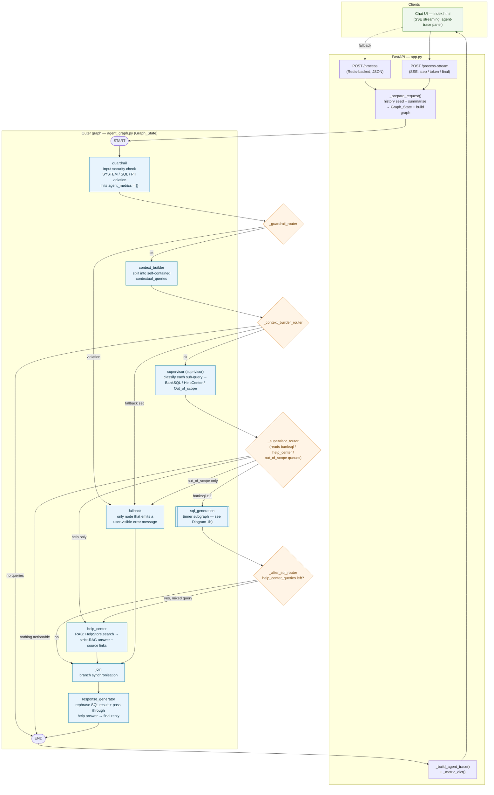
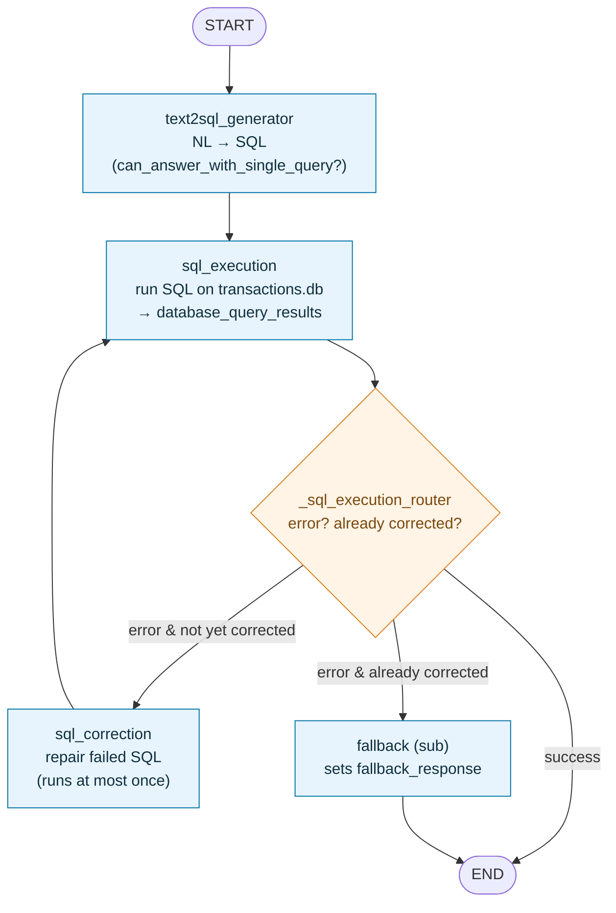
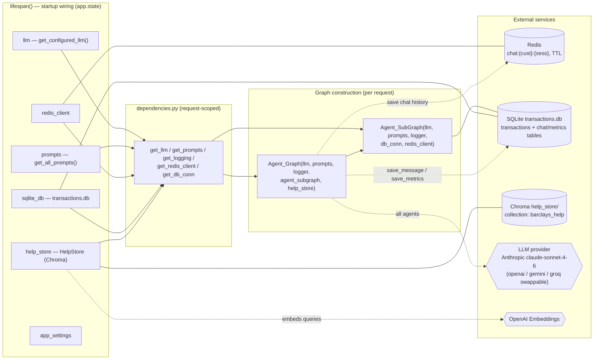
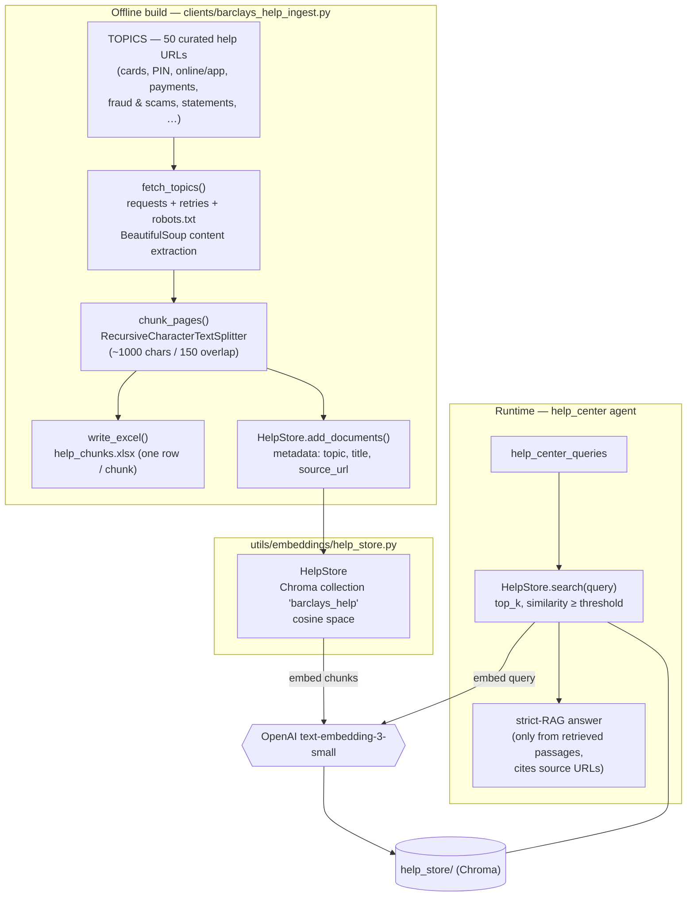
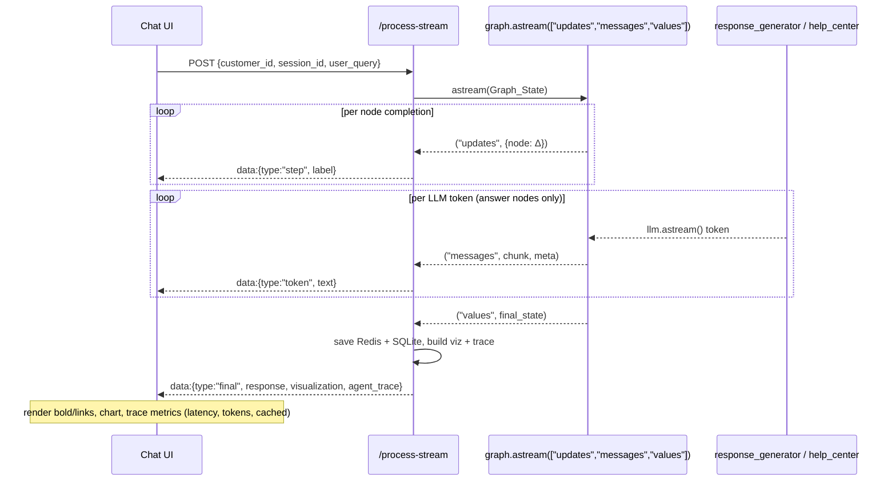

# FinTell — Functional Workflow & Architecture

Detailed diagrams of the FinTell banking chatbot: every agent, router, component and
how they connect. Diagrams are [Mermaid](https://mermaid.js.org/) — they render on
GitHub and in VS Code (Markdown Preview Mermaid Support).

- **Diagram 1** — End-to-end request flow (API → outer LangGraph → inner SQL subgraph → response).
- **Diagram 2** — Runtime components & infrastructure wiring (app.state, DI, external services).
- **Diagram 3** — Help-centre RAG ingestion pipeline (offline) + retrieval (runtime).
- **Diagram 4** — Streaming (SSE) sequence.

---

## Diagram 1 — Request flow: API, agents & routers

> **Note on routing:** `_supervisor_router` picks a single primary route; when a message
> mixes a BankSQL query **and** a help query it routes to `sql_generation` first, and
> `_after_sql_router` then chains into `help_center` (sequential — so both branches never
> write the shared `agent_metrics` channel concurrently).

---

## Diagram 1b — Inner SQL subgraph (agent_subraph.py · SubGraph_State)

> The outer graph adds this compiled subgraph **as a node** (`add_node("sql_generation",
> agent_subgraph.app)`), so `Graph_State` and `SubGraph_State` stay field-compatible
> (e.g. `text2sql_generator_response`, `database_query_results`, `sql_query_correction`,
> `banksql_queries`, `agent_metrics`).

---

## Agent reference (per-agent contract)

Every agent is `async fn(state, llm, prompt, logger) → state`, calls the LLM, computes
`agent_metrics[<name>]`, and wraps its body in try/except that sets `fallback_response`.

| Agent | File | LLM call style | Prompt |
|---|---|---|---|
| guardrail | agents/guardrails.py | structured output | hardcoded in function |
| context_builder | agents/context_builder.py | structured output | context_builder_prompt.yml |
| supervisor | agents/supervisor.py | structured output | suprivisor_prompt.yml |
| text2sql_generator | agents/text2sql_generator.py | structured output | text2sql_generator.yml |
| sql_execution | agents/sql_execution.py | — (DB call) | — |
| sql_correction | agents/sql_correction.py | structured output | sql_correction.yml |
| help_center | agents/help_center_agent.py | **streamed plain text** (`llm.astream`) | help_center_prompt.yml |
| response_generator | agents/response_generator.py | **streamed plain text** (`llm.astream`) | response_generator_prompt.yml |
| fallback | agents/fallback.py | — | — |

---

## Diagram 2 — Runtime components & infrastructure

---

## Diagram 3 — Help-centre RAG: offline ingestion + runtime retrieval

---

## Diagram 4 — Streaming (SSE) sequence — /process-stream

---

## Data model (the only SQL target)

`transactions(transaction_id PK, customer_id, card_number, transaction_date, year, month,
day, amount_usd, transaction_type, balance, merchant_brand_name,
merchant_system_category1_name, merchant_system_category2_name)`

- `transaction_type` ∈ {income, payment, direct_debit, standing_order}
- `amount_usd` always positive (direction comes from `transaction_type`)
- `balance` = running account balance after each transaction

---

## Reference: agents, endpoints, data layout

### Agents

Each agent is a stand-alone async function in `src/agents/`.

| Agent | File | Role |
|---|---|---|
| `guardrail` | [src/agents/guardrails.py](../src/agents/guardrails.py) | First node. LLM-based input check (SYSTEM / SQL / PII violation, or GREETING). Prompt is hardcoded in the function — no YAML. Initializes `agent_metrics = {}`. |
| `context_builder` | [src/agents/context_builder.py](../src/agents/context_builder.py) | Splits the query + chat history into one or more self-contained `contextual_queries`. |
| `supervisor` | [src/agents/supervisor.py](../src/agents/supervisor.py) | Classifies each sub-query into `banksql_queries`, `help_center_queries` or `out_of_scope_queries`. |
| `text2sql_generator` | [src/agents/text2sql_generator.py](../src/agents/text2sql_generator.py) | NL → SQL, with a Redis + SQLite (`query_cache`) cache keyed on customer + query. |
| `sql_execution` | [src/agents/sql_execution.py](../src/agents/sql_execution.py) | Runs the SQL; auto-adds/clamps `LIMIT` to `MAX_RESULT_ROWS` (20). |
| `sql_correction` | [src/agents/sql_correction.py](../src/agents/sql_correction.py) | Repairs a failed SQL query (runs at most once). |
| `help_center` | [src/agents/help_center_agent.py](../src/agents/help_center_agent.py) | Strict-RAG answer from `HelpStore` (Chroma, `help_store/`); grounded "couldn't find it" reply when nothing clears the similarity threshold. |
| `response_generator` | [src/agents/response_generator.py](../src/agents/response_generator.py) | Rephrases SQL results (and passes through help answers) into the final reply. |
| `fallback` | [src/agents/fallback.py](../src/agents/fallback.py) | Turns `state.fallback_response` into a user-visible message (no LLM, no prompt). |
| `history_summarizer` | [src/agents/history_summarizer.py](../src/agents/history_summarizer.py) | Not a graph node; called from `_prepare_request` to compress long chat history (once there are ≥5 prior user turns). |

### API endpoints

| Method | Path | Description |
|---|---|---|
| `GET` | `/` | Serves `src/index.html` (the chat UI). |
| `POST` | `/login` | Validates `user_id` + `password` against env vars `DASHBOARD_USER_IDS` / `DASHBOARD_PASSWORD`. |
| `POST` | `/process-stream` | SSE variant used by the UI: emits `step`, `token`, then a `final` event (`response`, `visualization`, `agent_trace`). |
| `POST` | `/process` | Non-streaming equivalent. Returns `{response, visualization, agent_trace}`. |
| `GET` / `DELETE` | `/chat-history/{customer_id}` | List a customer's sessions/messages; delete all but `keep_session_id`. |
| `GET` | `/health` | Redis + DB liveness. |
| `POST` | `/update-settings` | Hot-swaps the active LLM provider/temperature/max_tokens in `app.state.llm`. |

`visualization` is currently always `null`: no graph node sets `visualization_response`.

### State, persistence, and external services

- **SQLite** `transactions.db` at the repo root (`AppSettings.db_path`, resolved against the project root) holds the `transactions` table plus app tables created at startup by `db_utils.setup_chat_tables`: `chat_sessions`, `chat_messages`, `request_metrics`, `query_cache`.
- **Redis** (`REDIS_URL`, default `localhost:6379`) stores per-session chat history under `chat:{customer_id}:{session_id}` (TTL `REDIS_TTL`) and the SQL cache under `qcache:{customer_id}:{digest}` (24h).
- **Chroma** `help_store/` (collection `barclays_help`) is the help-centre knowledge base, opened in `lifespan`.
- **FastAPI DI** — [src/dependencies.py](../src/dependencies.py) provides `get_llm`, `get_prompts`, `get_logging`, `get_redis_client`, `get_db_conn` from `app.state`.

### Data layout

- `data/data_processing/` — raw `df_transaction_data.xlsx` → `df_transaction_data_preprocessed.xlsx` (via `data/transaction_data_preprocess.py`) → `df_transaction_data_enhanced.xlsx` (via `transaction_data_enhance.py build`) → `transactions.db`.
- `help_chunks.xlsx` — inspection dump of the chunks embedded into `help_store/`.
- `tests/data/` — curated evaluation datasets (golden set, context-builder eval sets).
