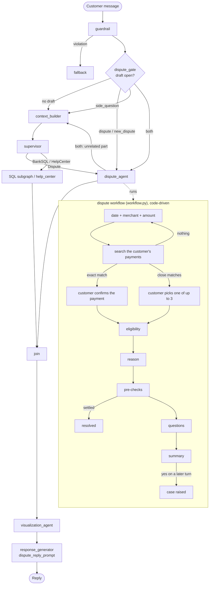

# Disputes agent

The Disputes agent lets a customer raise a **non-fraud card dispute** from the chat. It finds the
payment, checks it can be disputed, asks the questions for the dispute reason, shows a summary
and raises a case once the customer confirms it.

It is added to the existing LangGraph workflow. The guardrail, context builder, supervisor,
SQL, help-centre and response agents work as before; the supervisor has one new class, `Dispute`.

---

## 1. Scope

**In scope**

- Card payments (`transaction_type = 'payment'`) on the signed-in customer's own account.
- Seven reasons, set in `prompts/dispute_types.yml`:

  | Reason id | What the customer says | Visa code (reference only) |
  |---|---|---|
  | `duplicate_charge` | I was charged twice for the same thing | 12.6 |
  | `wrong_amount` | I was charged the wrong amount | 12.5 |
  | `refund_not_received` | I returned or cancelled something and haven't had my refund | 13.6 |
  | `goods_not_received` | I never received the goods or service | 13.1 |
  | `not_as_described` | What I got wasn't as described, or it's faulty | 13.3 |
  | `cancelled_subscription` | I was charged after cancelling a subscription | 13.2 |
  | `unrecognised` | I don't recognise this payment | – (triage, see 4.5) |

- Questions from the customer that are not about the dispute, asked while one is open. They
  are answered as normal and the dispute stays open (see section 5).

**Out of scope**

- **Fraud.** A payment the customer does not recognise is never filed as a dispute. It is
  recorded as `suspected_fraud` and marked for the fraud team.
- **Card services**, such as blocking or replacing a card.
- Direct debits, standing orders and income. These get a short explanation of why they cannot
  be disputed here.
- Payments older than the dispute window (`DISPUTE_WINDOW_DAYS`, 120 days by default).
- **"How do I dispute a payment?"** This is still classed `HelpCenter` and answered from the
  help centre. `Dispute` is only for a customer reporting a problem with a payment of their own.
- **Anything after the case is raised.** A case is a row in the `disputes` table. No
  downstream case-management or chargeback system is called.

---

## 2. How it works

Each turn the model makes **one** structured call (`DisputeTurnExtraction`). It reads the
amount, date, merchant, reason, answers to the questions, and the customer's intent (provide
info, confirm, decline, cancel or unclear) from the message. **Code decides everything else:**
what to ask next, the database lookups, eligibility, and whether a case is raised. The model
never writes SQL on this path and cannot raise a case.

The steps, in order:

1. **Find the payment.** The customer gives the date, merchant and amount (section 3).
2. **Confirm the payment.** The customer confirms the merchant, amount and date read from the
   database.
3. **Check eligibility.** It must be a card payment, inside the window and not already
   disputed. This runs as soon as a payment is found, before the customer is asked to confirm it.
4. **Confirm the reason.** If the reason is unclear, the customer is shown a menu of the seven.
5. **Pre-checks.** Fixed SQL that can sometimes settle the matter at once (section 4.4).
6. **Ask that reason's questions**, at most two per turn.
7. **Show a summary** and ask for an explicit yes.
8. **Raise the case** and return the case ID.



The agent returns a `DisputeResult`, which carries a status and the facts. The status is one
of `needs_transaction`, `needs_payment_confirmation`, `needs_transaction_choice`,
`not_eligible`, `needs_reason`, `needs_info`, `needs_confirmation`, `resolved`,
`suspected_fraud`, `filed`, `cancelled` or `error`. `response_generator` turns the result
into the reply using `prompts/dispute_reply_prompt.yml`. If that call fails, it uses the fixed
wording in `plain_reply()`. The case ID is always added to the reply if the model leaves it out.

---

## 3. Finding the payment

The customer must give **all three** of the date, the merchant and the amount before anything
is searched. If any are missing, the agent asks only for those. It remembers what was already
said across turns.

| Detail | Rule |
|---|---|
| Date | Must be **exact**. The model is given today's date, so "13 June" and "yesterday" work. Future or impossible dates are rejected. |
| Merchant | **Fuzzy** match. Case and punctuation are ignored. Part of the name ("Northern Hotel"), initials ("GNH") and typos ("Grate Nothern") all match. The match is scored 0–1 and must reach `DISPUTE_MERCHANT_MATCH` (0.6). |
| Amount | Within **±£3** (`DISPUTE_AMOUNT_TOLERANCE`). It must be greater than zero. |

The search (`checks.find_transactions`) is a fixed, parameterised query over the signed-in
customer's own rows. It covers every transaction type, so a direct debit gets a clear "can't be
disputed here" answer instead of "not found".

- **Exact match** (amount to the penny and the merchant matches fully): the agent shows the
  merchant, amount and date from the database and asks *"Is this the payment you want to
  dispute?"*. The yes must come in a later message.
- **No exact match, but close ones**: it says there was no exact match and lists **up to 3**,
  ordered by how close the amount is, then how well the merchant matches. The customer picks
  one ("the second one", "the £254 one"). The pick can only be one of the listed IDs, and it
  counts as the confirmation.
- **Nothing found**: it says so and asks the customer to check the details. The same failed
  search is not run twice in a row.
- **"No" / "none of those"**: the details are cleared and asked for again. A new date, merchant
  or amount starts a new search.

Until a payment is confirmed, nothing else in the dispute goes ahead. Anything the customer
already said, such as the reason or a description, is kept for later.

---

## 4. Key behaviour

### 4.1 Human in the loop

The customer confirms twice: first the **payment**, then the **final summary**. A case is
raised only when **all** of these hold (in `workflow._run_turn`):

- the summary was saved as `awaiting_confirmation` on an **earlier** turn;
- this message is a "yes" (`intent = confirm`);
- the message changes no details;
- the message does not also carry another request (`allow_confirm`);
- the draft's fingerprint still matches what was shown.

Nothing else in the code writes a case. Raising the same case again returns the existing case
ID, because a unique index on customer + payment + reason prevents duplicates.

### 4.2 Questions per reason

Each reason has three questions of its own. Most reasons also share common questions: *what
happened* (asked first) and *contacted the merchant?* / *evidence?* (asked last). Questions can
use `{merchant}`, `{amount}` and `{date}`. The workflow fills these from the transaction.
When the customer's first message already describes the problem, it is used as the
description and that question is not asked again. Adding or changing a reason is an edit to
`prompts/dispute_types.yml`; the reason id must also be added to `DisputeReason` in `app_models.py`.

### 4.3 Eligibility

`checks.check_eligibility`:

- the transaction must be a card `payment`;
- it must be no older than `DISPUTE_WINDOW_DAYS`, measured from **real today**;
- it must have no open dispute already.

A payment that fails is explained by name, and no draft is kept.

### 4.4 Pre-checks (fixed SQL)

| Reason | Check | Possible outcome |
|---|---|---|
| `duplicate_charge` | Same merchant and amount within `DUPLICATE_WINDOW_DAYS` (3) | Found: supports the dispute. Not found and the payments are monthly: **resolved** as a normal recurring charge. |
| `refund_not_received` | Incoming credit from the merchant after the payment | Found: **resolved** ("that looks like the refund", or a partial refund). Payment less than `REFUND_WAIT_DAYS` (10) ago: **resolved**, too early. |
| `cancelled_subscription` | At least `RECURRING_MIN_PRIOR_PAYMENTS` (2) earlier payments to the merchant | Noted as a recurring charge. |

### 4.5 Unrecognised payments (triage)

If the customer has paid the merchant regularly before, the agent first asks whether they
recognise the payment now:

- **Yes:** the dispute is **resolved** with nothing to dispute.
- **No:** it asks two questions: does anyone else use the card, and is the card still with
  them? It then ends as **`suspected_fraud`**. A `dispute_events` row marks it for the fraud
  team, and the customer is told to contact the bank. A dispute case is never raised.

---

## 5. Continuity: other questions mid-dispute

The in-progress dispute is a **draft** in SQLite (`dispute_drafts`, one per customer and
session). It is ignored after `DISPUTE_DRAFT_MAX_AGE_HOURS` (24). It is kept in SQLite, not
Redis, because Redis is optional in this app.

`dispute_gate` runs after the guardrail on every request. With no draft open it does nothing.
With one open, a single model call sets `message_kind`:

| `message_kind` | Example | What happens |
|---|---|---|
| `dispute` | "It was £45" | The dispute continues. |
| `side_question` | "What's my balance?" | The question goes through the normal pipeline, and the reply ends with a reminder of what the dispute is waiting for. |
| `both` | "£30, and what did I spend on groceries?" | The dispute continues and the unrelated part (`pipeline_query`) is answered too. A "yes" in such a message never confirms. |
| `new_dispute` | "Forget that, dispute my Tesco payment" | The old draft is dropped and a new dispute starts. |

The gate's reading is passed to `dispute_agent`, so the message is read only once.
`dispute_agent` runs at most once per request (`dispute_handled`), so the graph cannot loop.

The guardrail classes a bare "yes" or "ok" as a greeting. That verdict is ignored while a
draft is open.

---

## 6. Data stored

These tables are created by `db_utils.setup_chat_tables` (`CREATE IF NOT EXISTS`, safe on the
existing DB):

| Table | Contents |
|---|---|
| `dispute_drafts` | One in-progress dispute per (session, customer) as JSON. It is removed once the dispute is filed, resolved, cancelled or handed off. |
| `disputes` | Raised cases: `case_id` (`DSP-XXXXXXXX`), customer, transaction, reason, answers, status (`open`), created time. There is a unique open case per customer + transaction + reason. |
| `dispute_events` | The audit trail: `draft_started`, `reason_set`, `reason_changed`, `not_eligible`, `summary_shown`, `confirmed`, `filed`, `resolved`, `cancelled`, `suspected_fraud`. |

---

## 7. Configuration

These are in `src/app_setting.py` and can be overridden with environment variables:

| Setting | Default | Meaning |
|---|---|---|
| `DISPUTE_WINDOW_DAYS` | 120 | A card payment older than this cannot be disputed. |
| `DISPUTE_AMOUNT_TOLERANCE` | 3.0 | How many pounds out the customer's amount can be. |
| `DISPUTE_MERCHANT_MATCH` | 0.6 | The 0–1 similarity a merchant name needs to count as a match. |
| `DISPUTE_MAX_CHOICES` | 3 | How many close payments are offered. |
| `DUPLICATE_WINDOW_DAYS` | 3 | Same merchant and amount within this many days counts as a duplicate. |
| `REFUND_WAIT_DAYS` | 10 | How long a refund can take before it can be disputed. |
| `RECURRING_MIN_PRIOR_PAYMENTS` | 2 | Earlier payments to a merchant before it counts as recurring. |
| `DISPUTE_DRAFT_MAX_AGE_HOURS` | 24 | An untouched draft is ignored after this long. |

> **Demo note:** the bundled `transactions.db` ends on 2026-06-13, so with the default window
> every payment is "not eligible". To demo, set `DISPUTE_WINDOW_DAYS=2000`, or re-base the dates
> with `python data/data_processing/transaction_data_enhance.py shift` and rebuild the DB.

---

## 8. Files

### New

| File | Purpose |
|---|---|
| [src/agents/disputes/workflow.py](../src/agents/disputes/workflow.py) | The workflow. `run_dispute_turn` and the gate's `extract_for_open_draft` live here, as do the payment search and confirmation, the confirmation gate, unrecognised triage, `pending_reminder` and `plain_reply`. |
| [src/agents/disputes/checks.py](../src/agents/disputes/checks.py) | Fixed SQL, with no model calls: `find_transactions`, `merchant_score`, `is_exact_match`, eligibility, duplicate, recurring and refund checks. |
| [src/agents/disputes/registry.py](../src/agents/disputes/registry.py) | Loads and validates `dispute_types.yml`. |
| [src/agents/disputes/\_\_init\_\_.py](../src/agents/disputes/__init__.py) | Package marker. |
| [prompts/dispute_types.yml](../prompts/dispute_types.yml) | The question set for each reason. This is configuration, not a prompt. |
| [prompts/dispute_extraction_prompt.yml](../prompts/dispute_extraction_prompt.yml) | The system prompt for the once-per-turn extraction call, used by both `dispute_gate` and `dispute_agent`. |
| [prompts/dispute_reply_prompt.yml](../prompts/dispute_reply_prompt.yml) | The system prompt that words a `DisputeResult` as a reply. |
| [tests/conftest.py](../tests/conftest.py), [tests/fakes.py](../tests/fakes.py) | Test fixtures (in-memory DB, fixed "today", `add_txn`) and a scripted fake chat model. No API keys are needed. |
| [tests/test_disputes_checks.py](../tests/test_disputes_checks.py) | The SQL checks and the payment search. |
| [tests/test_dispute_workflow.py](../tests/test_dispute_workflow.py) | The workflow turn by turn: finding and confirming the payment, reasons, pre-checks, the confirmation gate and triage. |
| [tests/test_dispute_graph.py](../tests/test_dispute_graph.py) | Graph routing: the gate, continuity, mixed messages, the guardrail override and the reply writer. |

### Changed

| File | Change |
|---|---|
| [src/agent_graph.py](../src/agent_graph.py) | New nodes `dispute_gate` and `dispute_agent`. New routers `_dispute_gate_router` and `_after_dispute_router`, and dispute routes in the supervisor router. The guardrail's greeting verdict is ignored while a draft is open. |
| [src/app_models.py](../src/app_models.py) | `DisputeReason`, `DisputeTurnExtraction`, `DisputeDraft`, `DisputeResult`. New `Graph_State` fields: `dispute_queries`, `dispute_open`, `dispute_gate_kind`, `dispute_handled`, `dispute_extraction`, `dispute_result`, `dispute_reminder`, `pipeline_query`. The two prompts are added to `Prompts`. |
| [src/app_setting.py](../src/app_setting.py) | The dispute settings (section 7) and the paths of the new prompt and config files. |
| [src/app.py](../src/app.py) | Loads the reason registry at startup. Adds `dispute_gate` and `disputes` entries to the agent trace. Totals metrics for agents that run more than once. Streams the dispute reminder as a final token. |
| [src/agents/supervisor.py](../src/agents/supervisor.py), [prompts/suprivisor_prompt.yml](../prompts/suprivisor_prompt.yml) | The new `Dispute` class, with examples separating it from `HelpCenter` and `BankSQL`. |
| [src/agents/context_builder.py](../src/agents/context_builder.py) | Uses `pipeline_query`, the unrelated part of a mixed message, when it is set. |
| [src/agents/response_generator.py](../src/agents/response_generator.py) | `_dispute_reply` writes dispute replies from the result only, without chat history, so every fact comes from the database. It falls back to `plain_reply`. |
| [src/utils/db_utils.py](../src/utils/db_utils.py) | The three dispute tables and their helpers: draft get, save and clear; `create_dispute`; `has_open_dispute`; `add_dispute_event`. |
| [src/utils/agent_utils.py](../src/utils/agent_utils.py) | `record_metric`, which stores repeat calls as `name_2`, `name_3`, and so on. |
| [src/utils/file_utils.py](../src/utils/file_utils.py) | Loads the two new prompts. |
| [src/index.html](../src/index.html) | Icons and detail panels for the `dispute_gate` and `disputes` trace steps. |
| [requirements.txt](../requirements.txt) | Adds `pytest`. |
| `.env.example`, `CLAUDE.md` | Document the dispute settings and the design. |

---

## 9. Testing

```powershell
python -m pytest tests -q        # 140 tests, scripted fake model, no API keys
```

The tests check the code paths, not the real model. The flows were also run by hand against the
live app (Claude Sonnet 4.6) on a copy of the DB with `DISPUTE_WINDOW_DAYS=2000`. Those runs
covered:

- a fuzzy merchant name giving a choice;
- a missing merchant being asked for, then an exact match;
- three close Kim Store payments listed and one picked;
- "not found" for a wrong amount or a date one day out;
- mixed and side questions mid-dispute;
- unrecognised payments ending as suspected fraud;
- switching to a different dispute.

---

## 10. Known limitations

- A raised case is only stored locally. The fraud hand-off is an audit row; nothing is sent to
  a real team or system.
- The customer's "yes" is read by the model. The code gate (summary shown on an earlier turn,
  details unchanged) limits the effect of a mis-read, but does not remove it.
- The `transactions` table stores amounts as `amount_usd`, but the agent shows them in pounds,
  as the rest of the app does.
- After a payment is found to be "not eligible", no draft is kept. A following bare "yes" is
  treated as a new message, so the customer gets a general greeting.
- The help-centre question "how do I dispute?" and the action "dispute this" are told apart by
  the supervisor prompt. Borderline wording can go either way.
