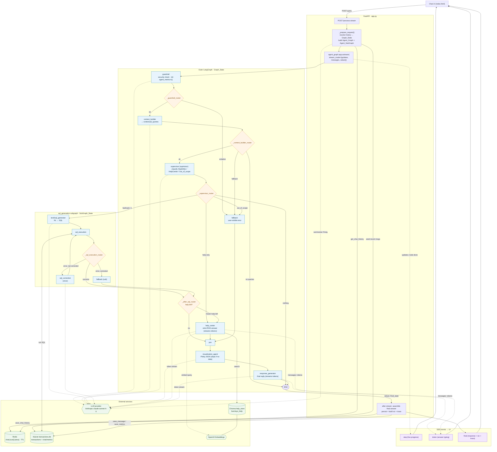

# `/process-stream` — Single End-to-End Diagram

One diagram tracing a streaming request through every component: agents, routers,
Redis, SQLite (`transactions.db`), Chroma help store, OpenAI embeddings, the LLM, and
the SSE event lane back to the UI. (Mermaid — renders on GitHub / VS Code.)

**Legend**

- **Blue** = agents · **Orange** = routers · **Green** = external services · **Purple** = SSE events.
- Solid arrows = control flow; dotted arrows = service calls (LLM / embeddings / token streams).
- `astream` runs three stream modes at once: `updates` → **step** events, `messages` →
  **token** events (only `response_generator` / `help_center` are surfaced), `values` →
  the final state used for persistence and the **final** event.
